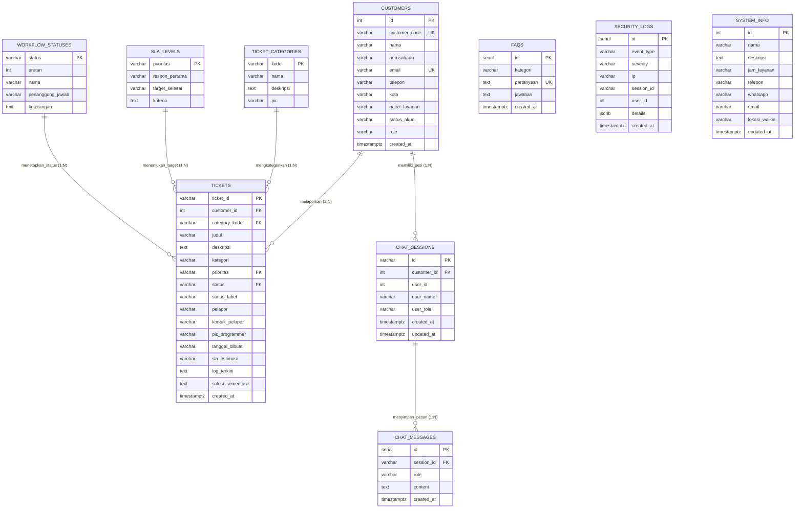
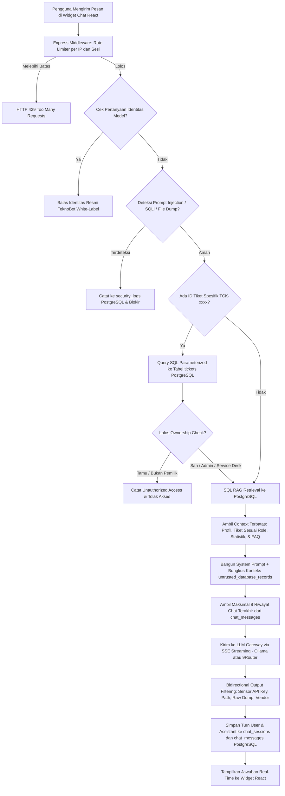
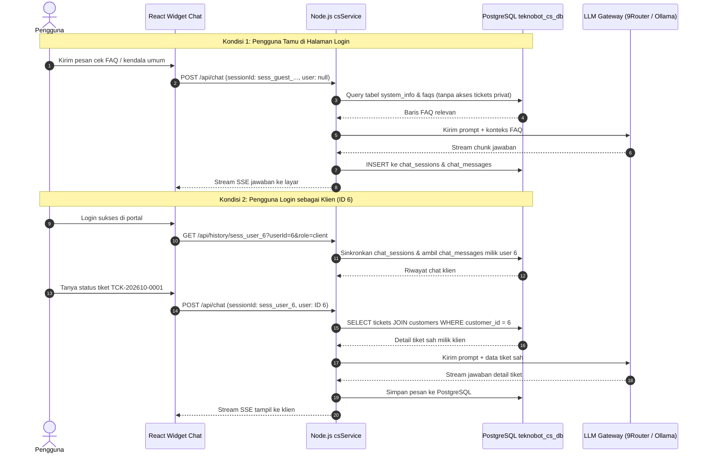

# Dokumentasi Arsitektur, ERD, dan Alur Program TeknoBot CS (PostgreSQL)

Dokumen ini menjelaskan rancangan database (**ERD**), **Alur Program (Flowchart)**, serta **Diagram Interaksi (Sequence Diagram)** untuk microservice **Customer Service AI (TeknoBot)** yang terintegrasi langsung dengan **PostgreSQL** (`teknobot_cs_db`).

---

## 1. Entity Relationship Diagram (ERD) Database PostgreSQL

### Ringkasan Dataset Terisi (>= 100 Data):
| Tabel | Jumlah Data | Fungsi Utama |
| :--- | :---: | :--- |
| `customers` | **105 baris** | Data profil pelanggan/klien dan peran akun sistem |
| `tickets` | **120 baris** | Data tiket kendala IT terhubung ke pelanggan & kategori |
| `faqs` | **25 baris** | Basis pengetahuan panduan troubleshooting mandiri |
| `workflow_statuses` | **11 baris** | Referensi alur status penanganan tiket |
| `ticket_categories` | **5 baris** | Kategori kendala (Software, Hardware, Jaringan, Akun, Walk-In) |
| `sla_levels` | **4 baris** | Target waktu respon dan penyelesaian (Urgent - Low) |
| `chat_sessions` & `chat_messages` | Dinamis | Penyimpanan riwayat percakapan chatbot per sesi |
| `security_logs` | Dinamis | Audit insiden guardrail keamanan (OWASP LLM01/LLM06) |

---

## 2. Flowchart Alur Program Chatbot AI (TeknoBot)

---

## 3. Sequence Diagram (Alur Sesi Reaktif Login/Logout & PostgreSQL)

